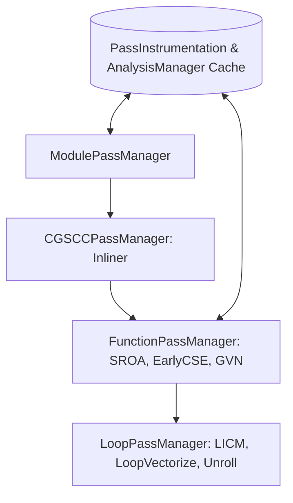

# LLVM New Pass Manager Optimization Pipeline

LLVM's modern Pass Manager organizes compiler optimizations across module, call graph SCC, function, and loop nesting granularities, validating dependencies using cached Analysis Managers.



---

## 1. Analysis Preservation Contract

```cpp
// Explicit preservation contract prevents expensive re-analysis
PreservedAnalyses run(Function &F, FunctionAnalysisManager &FAM) {
    auto &DominatorTree = FAM.getResult<DominatorTreeAnalysis>(F);
    // Execute instruction folding...
    PreservedAnalyses PA;
    PA.preserve<DominatorTreeAnalysis>();
    return PA;
}
```
