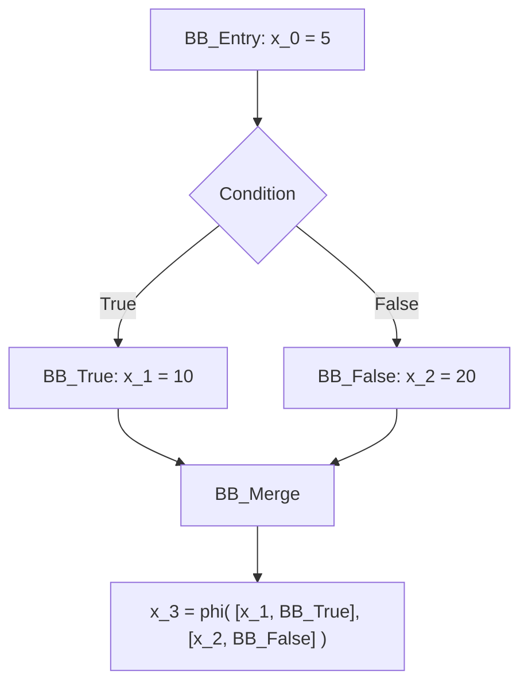

# Compiler Engineering: LLVM SSA Form and Dominance Frontiers

In Static Single Assignment (SSA) form, every variable is assigned exactly once. When control flow branches merge, $\phi$ (Phi) nodes select the value based on the predecessor basic block.

---

## 1. Optimization Power
SSA form dramatically simplifies compiler optimization passes:
- Dead Code Elimination (DCE)
- Sparse Conditional Constant Propagation (SCCP)
- Global Value Numbering (GVN)
