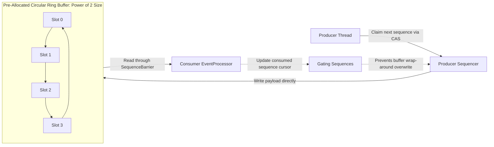

# LMAX Disruptor: Lock-Free Ring Buffer & Sequencer Architecture

The LMAX Disruptor eliminates queue lock contention and cache line bouncing in low-latency systems through a pre-allocated circular ring buffer coordinated by atomic memory sequencers and sequence barriers.

---

## 1. Mechanical Sympathy Principles

1. **Zero Garbage Collection:** Entries are pre-allocated at startup and mutated in place, avoiding heap allocations in the critical path.
2. **False Sharing Elimination:** Sequence numbers are padded with 56 bytes of dummy cache line space (7 longs) to isolate them to dedicated 64-byte L1 CPU cache lines.
3. **Wait Strategies:**
   * `BusySpinWaitStrategy`: Lowest latency (<100ns), consumes 100% CPU on pinned core.
   * `YieldingWaitStrategy`: Yields CPU thread timeslice (`Thread.yield()`) on contention.
   * `BlockingWaitStrategy`: Uses condition variable locks for power and CPU conservation.
