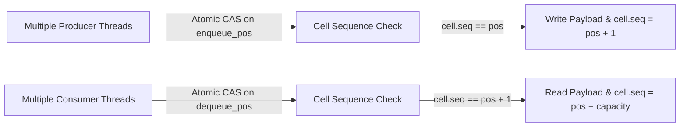

# Low Latency Data Structures: Dmitry Vyukov MPMC Bounded Queue

Vyukov's lock-free MPMC queue utilizes a circular array where each cell contains a sequence number to coordinate multiple concurrent producers and consumers with zero locks.

---

## 1. Invariants
- Enqueue succeeds only if cell sequence equals current turn.
- Dequeue succeeds only if cell sequence equals enqueue turn + 1.
- Operates entirely lock-free with $O(1)$ amortized cost.
