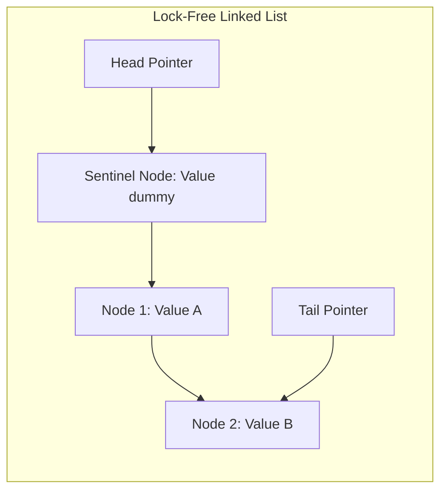

# Concurrency: Michael & Scott Lock-Free Queue Internals

The Michael & Scott lock-free queue uses linked lists with sentinel nodes, ensuring non-blocking concurrent enqueue and dequeue operations via Compare-And-Swap (CAS).

---

## 1. Enqueue Invariants

1. **Tail Swing:** A thread reads `tail` and `tail->next`. If `tail->next == NULL`, it attempts `CAS(&tail->next, NULL, newNode)`.
2. **Tail Advance:** After swinging the next pointer, the thread (or any helping thread that notices a lagging tail) executes `CAS(&tail, curTail, newNode)`.
3. **ABA Mitigation:** Pointer tagging or Epoch-Based Reclamation (EBR) prevents ABA pointer reuse bugs during memory deallocation.
