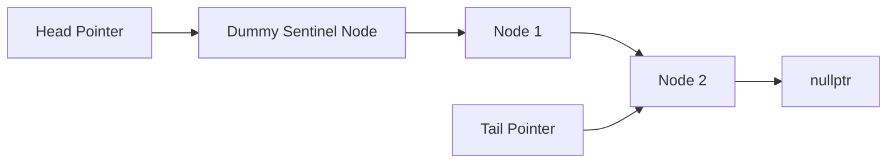

# Michael & Scott Lock-Free Queue Algorithm

The Michael-Scott queue is a non-blocking FIFO data structure utilizing atomic Compare-And-Swap (CAS) instructions.

---

## 1. Invariants

- Queue always contains at least one node: the **Dummy Sentinel Node**.
- Enqueue pushes to `Tail->next`, then advances `Tail`.
- Dequeue advances `Head` and claims the payload of the subsequent node.
- Concurrent enqueue threads assist lagging threads by swinging `Tail` forward if observed behind.
