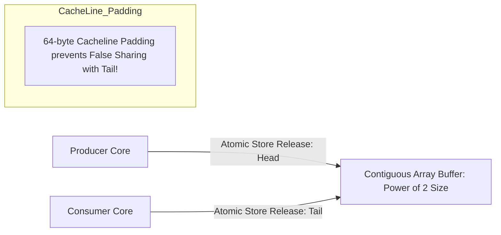

# High-Frequency Trading: Single-Producer Single-Consumer (SPSC) Ring Buffer

The lock-free SPSC ring buffer operates without mutexes or atomic CAS loops, relying entirely on memory order acquire/release semantics over a power-of-two circular array.

---

## 1. Masking Optimization
When the buffer capacity $C$ is a power of 2:
$$\text{index} = \text{sequence} \ \& \ (C - 1)$$
Replaces costly CPU integer division/modulo with a single-cycle bitwise AND.
