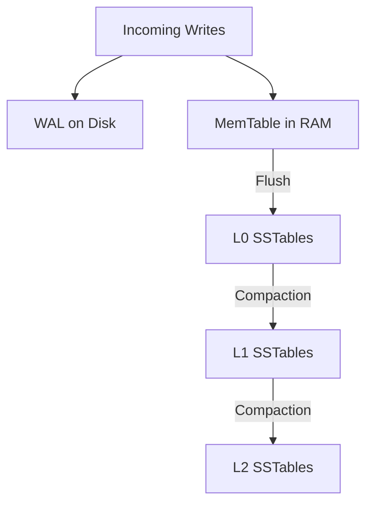

# Log-Structured Merge (LSM) Trees Compaction Strategies

LSM engines (RocksDB, Cassandra) optimize write throughput by converting random disk writes into sequential append-only writes.

---

## 1. Compaction Strategies

- **Size-Tiered Compaction**: Merges SSTables of similar size when a threshold count is reached. Favors write performance; high space amplification.
- **Leveled Compaction**: Divides disk into geometric levels ($L_1, L_2, \dots$ with factor 10x). SSTables within levels $>0$ have non-overlapping key ranges. Minimizes space amplification.
