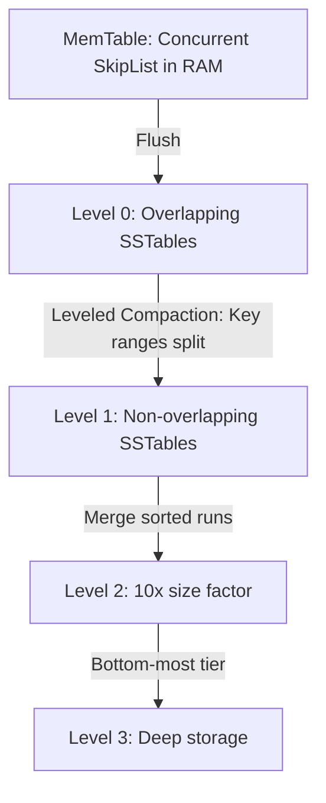

# LSM-Tree Compaction Strategies: Leveled vs Size-Tiered

Log-Structured Merge-Trees balance Write Amplification (WA), Read Amplification (RA), and Space Amplification (SA) by organizing immutable SSTables into hierarchical tiers.

---

## 1. Strategy Tradeoffs

| Metric | Size-Tiered Compaction (STCS) | Leveled Compaction (LCS) | FIFO Compaction |
|---|---|---|---|
| **Write Amplification** | Low (8x - 12x) | High (20x - 40x) | Lowest (1x - 2x) |
| **Read Amplification** | High (Multiple files per run) | Low (1-2 SSTables per level) | High |
| **Space Amplification** | High (~100% temporary overhead) | Low (10% - 15% overhead) | Very Low |
| **Primary Workload** | Heavy writes, append-only logs | Low-latency point lookups | Time-series, TTL data |
