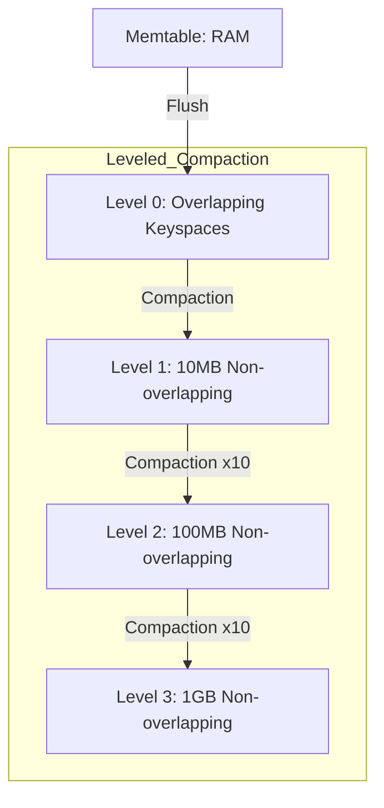

# Storage Engines: LSM-Tree Leveled vs Size-Tiered Compaction

Log-Structured Merge-Trees (LSM) buffer mutations in memory (Memtable) and flush sorted runs (SSTables) to disk, requiring background compaction to reclaim space and maintain read performance.

---

## 1. Tradeoff Analysis

| Metric | Size-Tiered Compaction (STCS) | Leveled Compaction (LCS) |
| :--- | :--- | :--- |
| **Write Amplification** | Lower (10-30x) | Higher (30-50x) |
| **Space Amplification** | High (Requires up to 50% free disk) | Low (~10% overhead) |
| **Read Amplification** | High (Multiple files per tier) | Low (Max 1 file per level for L1+) |
