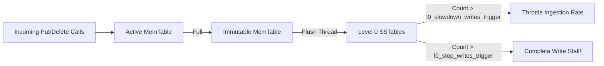

# Storage Systems: LSM-Tree Write Stalls and Flush Architecture

When background I/O cannot compact SSTables fast enough to keep up with incoming write rates, LSM-trees enforce write stalls or throttles to prevent unbounded disk amplification.

---

## 1. Tuning Parameters (RocksDB / LevelDB)
- `write_buffer_size`: Size of a single memtable before becoming immutable.
- `max_write_buffer_number`: Maximum number of memtables in memory before write stalls trigger.
- `level0_file_num_compaction_trigger`: Number of L0 files that initiates L0->L1 compaction.
