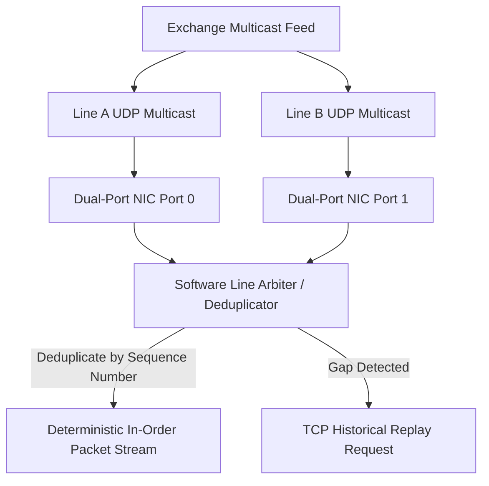

# A/B Multicast Feed Line Arbitration Architecture

Financial exchanges publish identical market data over two redundant UDP multicast lines (Feed A and Feed B). The client arbitrates lines to achieve zero packet loss.



---

## 1. Sequence Window Deduplication Logic

```cpp
#include <cstdint>
#include <vector>

class FeedArbiter {
public:
    FeedArbiter() : next_expected_seq_(1) {}

    enum class Status { PROCESS, DUPLICATE, GAP_DETECTED };

    Status process_packet(uint64_t seq_num, const uint8_t* payload, size_t len) {
        if (seq_num == next_expected_seq_) {
            next_expected_seq_++;
            dispatch(payload, len);
            drain_pending();
            return Status::PROCESS;
        } else if (seq_num < next_expected_seq_) {
            return Status::DUPLICATE; // Already processed from other feed
        } else {
            buffer_gap_packet(seq_num, payload, len);
            return Status::GAP_DETECTED; // Trigger TCP snapshot replay
        }
    }

private:
    uint64_t next_expected_seq_;
    void dispatch(const uint8_t*, size_t) {}
    void drain_pending() {}
    void buffer_gap_packet(uint64_t, const uint8_t*, size_t) {}
};
```
