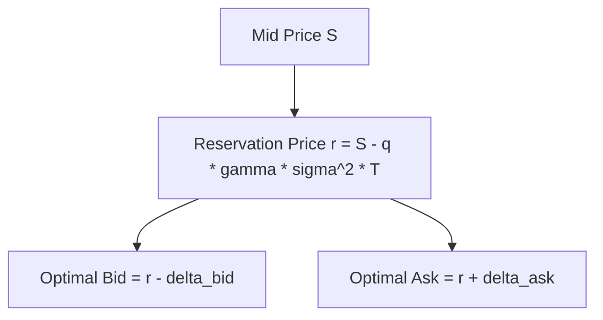

# Avellaneda-Stoikov Market Making & Inventory Skew

The Avellaneda-Stoikov model computes optimal bid-ask quotation spreads by skewing mid-prices according to accumulated inventory risk.

---

## 1. Mathematical Formulation

Let $S$ be the current mid price, $q$ the inventory position, $\gamma$ the risk-aversion parameter, $\sigma$ the volatility of the asset, and $T - t$ the remaining trading horizon.

The **Reservation (Indifference) Price** $r(s, q, t)$ is defined as:

$$r(s, q, t) = s - q \cdot \gamma \cdot \sigma^2 \cdot (T - t)$$

- When holding **positive inventory** ($q > 0$), the reservation price skews downward ($r < s$), causing the market maker to post deeper bids and tighter asks to encourage inventory reduction.
- When holding **negative inventory** ($q < 0$), the reservation price skews upward ($r > s$), discouraging sells and attracting buys.

---

## 2. Half-Spread Calculation

The optimal half-spread $\delta^a + \delta^b$ is given by:

$$\delta^a + \delta^b = \gamma \cdot \sigma^2 \cdot (T - t) + \frac{2}{\gamma} \ln\left(1 + \frac{\gamma}{\kappa}\right)$$

where $\kappa$ represents market order arrival intensity.
