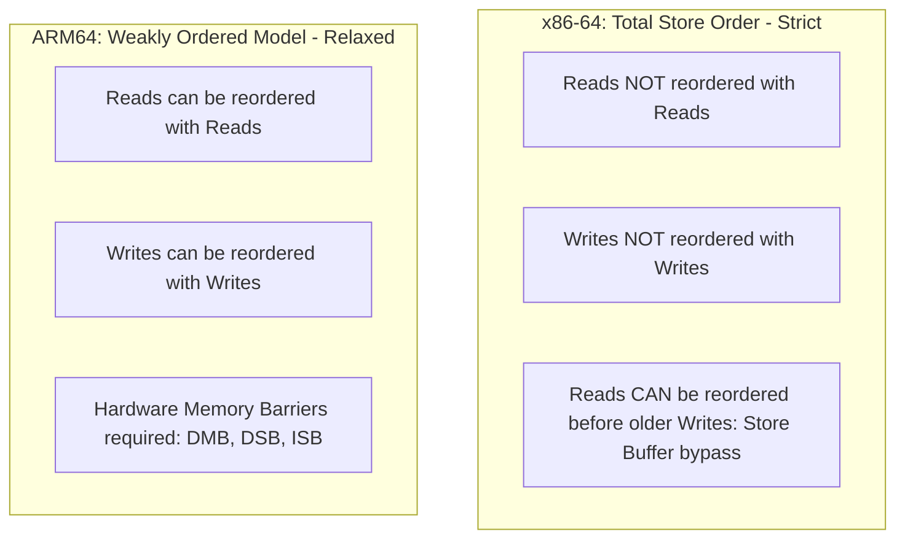

# Memory Ordering: x86 Total Store Order (TSO) vs ARM64 Weak Ordering

Processor architectures enforce different hardware memory consistency models, dictating when memory barriers and acquire/release fences are mandatory.

---

## 1. Hardware Barriers

| Architecture | Load-Load Reorder | Store-Store Reorder | Barrier Instruction |
|---|---|---|---|
| **x86-64** | No | No | `mfence` (prevents Store-Load bypass) |
| **ARM64** | Allowed | Allowed | `dmb ishld` (Load barrier), `dmb ish` (Full) |
