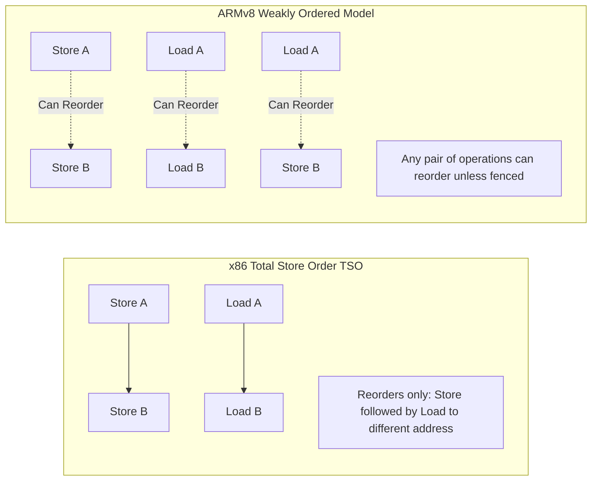

# Memory Models & Hardware Memory Barriers (x86 vs ARM)

Hardware memory architectures reorder reads and writes to maximize memory pipeline utilization unless explicit memory barriers or acquire/release semantics are specified.



---

## 1. Hardware Reordering Matrix

| Operation Sequence | x86-64 (TSO) | ARMv8 / Apple Silicon | RISC-V |
|---|---|---|---|
| Load $\to$ Load | Preserved | Reordered | Reordered |
| Load $\to$ Store | Preserved | Reordered | Reordered |
| Store $\to$ Store | Preserved | Reordered | Reordered |
| Store $\to$ Load | **Reordered** (Store Buffer) | Reordered | Reordered |

---

## 2. C++11 Memory Orders to Hardware Instructions

```cpp
#include <atomic>

std::atomic<int> flag{0};
int payload = 0;

void producer() {
    payload = 42;
    // x86: plain mov (TSO enforces store-store order)
    // ARMv8: dmb ishst / stlr
    flag.store(1, std::memory_order_release);
}

int consumer() {
    // x86: plain mov
    // ARMv8: ldar / dmb ishld
    while (flag.load(std::memory_order_acquire) == 0);
    return payload; // Guaranteed to see 42
}
```
