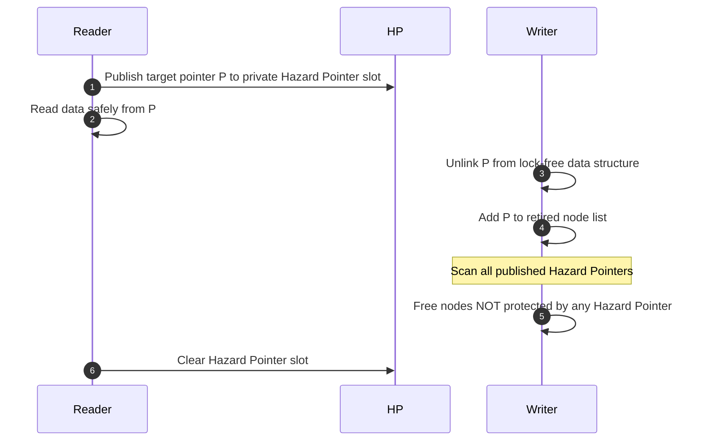

# Lock-Free Memory Reclamation: Hazard Pointers

Hazard pointers (Maged Michael) prevent the Use-After-Free and ABA problems in lock-free data structures without requiring garbage collection.

---

## 1. Principles

- Reader threads publish memory addresses they are actively inspecting into per-thread hazard pointer slots.
- Reclaiming threads accumulate retired nodes and only call `free()` on pointers not appearing in any active hazard slot.
