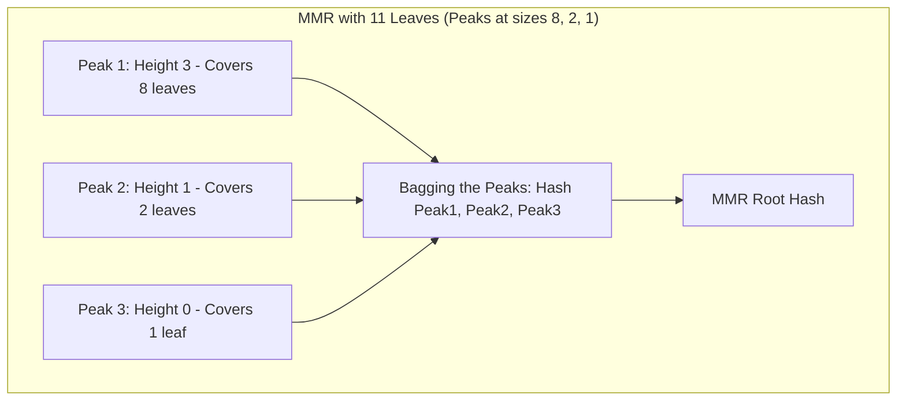

# Merkle Mountain Ranges (MMR) & Accumulators

A Merkle Mountain Range is an append-only cryptographic accumulator constructed as a list of balanced binary Merkle trees of decreasing power-of-two sizes, supporting $O(\log N)$ inclusion proofs and $O(1)$ append operations.

---

## 1. MMR vs Standard Merkle Trees

| Metric | Standard Balanced Merkle Tree | Merkle Mountain Range (MMR) |
|---|---|---|
| **Append Cost** | $O(N)$ or requires fixed tree depth. | $O(\log N)$ worst-case, $O(1)$ amortized. |
| **Historical Invalidation** | Appending alters root, rehashes branches. | **Append-only invariant:** Prior nodes never change index or hash. |
| **Pruning Support** | Complex sub-tree truncation. | Trivial leaf deletion by storing only peak hashes. |
| **Index Representation** | 1-based or 0-based leaf indexes. | Flat array post-order traversal indexing. |
