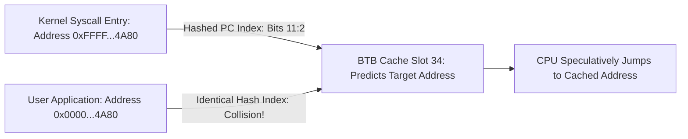

# CPU Microarchitecture: Branch Target Buffer (BTB) Aliasing & Branch Prediction

Branch Target Buffers cache target jump addresses using truncated program counter (PC) hashes, creating potential aliasing collisions where disjoint branch instructions share identical hardware BTB predictor entries.

---

## 1. Security & Performance Impact

1. **Branch Target Injection (Spectre v2):** An unprivileged user program executes branch instructions engineered to map to the same BTB entry as a target kernel branch, steering kernel speculative execution toward disclosure gadgets.
2. **Hardware Mitigations:**
   - **IBRS (Indirect Branch Restricted Speculation):** Hardware MSR flag preventing user code branches from influencing supervisor indirect predictions.
   - **IBPB (Indirect Branch Prediction Barrier):** Commands the CPU to flush all BTB branch predictor states across context switches.
