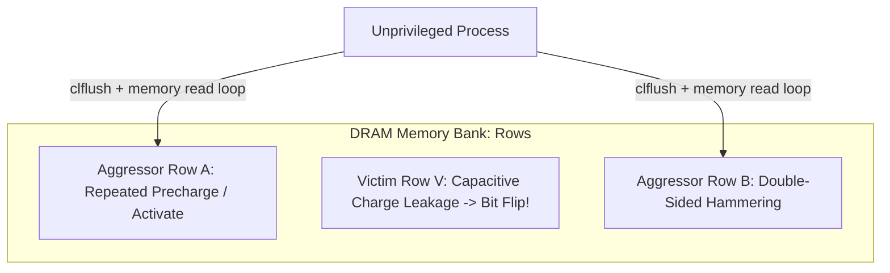

# Hardware Vulnerabilities: DRAM Rowhammer & Target Row Refresh (TRR)

Rowhammer exploits electromagnetic cross-talk in dense DDR4/DDR5 DRAM chips: repeatedly activating memory rows causes capacitor charge leakage that flips bits in adjacent physical memory cells.

---

## 1. Mitigation Techniques

1. **Target Row Refresh (TRR):** In-DRAM controller logic tracks activation frequencies of row addresses and proactively refreshes neighboring victim rows.
2. **Advanced Patterns (Blacksmith / Half-Double):** Exploit non-uniform refresh intervals and multi-row distance activations (hammering rows $N-2$ and $N+2$) to bypass first-generation TRR defenses.
3. **Hardware Countermeasures:** Bounded refresh rates, Pseudo-Target Row Refresh (pTRR), and memory controller-managed deterministic activation counters.
