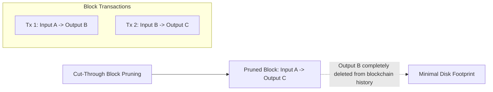

# Mimblewimble: Cut-Through Pruning & Confidential Transactions

Mimblewimble eliminates Bitcoin-style scripts and addresses, representing all transactions as Pedersen commitments and verifying blockchain history purely through transaction kernel excesses.

---

## 1. Kernel Excess Invariant

A transaction kernel contains the excess public key $E = \sum C_{	ext{out}} - \sum C_{	ext{in}}$ and a signature proving knowledge of the private blinding factor sum, proving the transaction creates no new coins from thin air.
