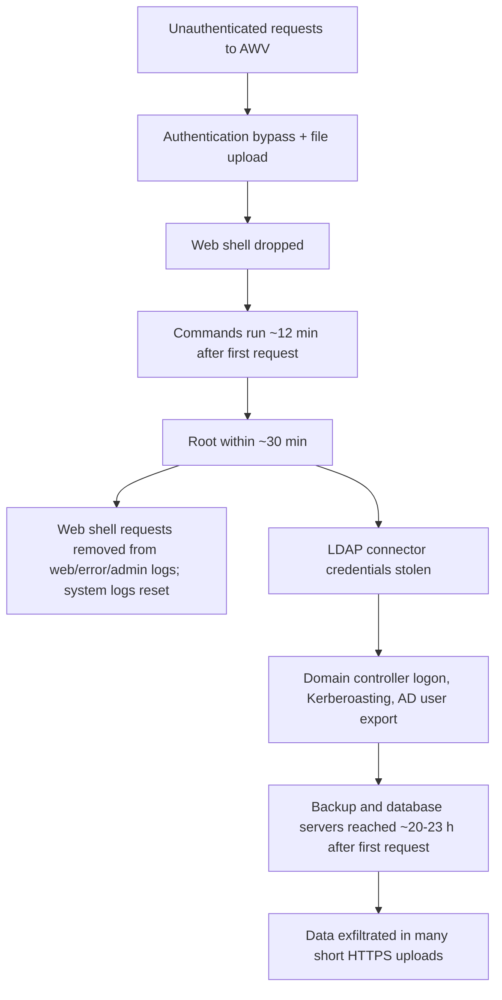

# Unified Communications Security: Mitel MiCollab AWV Vulnerability Chain (MISA-2026-0012)

Five unauthenticated vulnerabilities in the **Audio, Web and Video Conferencing (AWV)** component of Mitel MiCollab were fixed on 2026-11-16 and added to the CISA KEV catalog on 2026-11-25. Accenture APEX Labs reports exploitation **before** the advisory (web-shell activity on one victim before 23:00 UTC on 2026-11-15). Affected: MiCollab 10.3 (10.3.0.18) and all earlier versions.

---

## 1. Observed Attack Chain (Accenture APEX Labs)

---

## 2. Vulnerabilities

| CVE | Class | Mitel CVSS | Role in chain |
| :--- | :--- | :--- | :--- |
| CVE-2026-133323 | Blind OS command injection (CWE-78) | 10.0 (NVD 9.8) | Direct command execution, no authentication |
| CVE-2026-133303 | XML injection (CWE-91) | 9.0 (NVD 9.8) | Command execution using pre-staged content |
| CVE-2026-133324 | Not failing securely / authentication bypass | 5.3 | Access to protected functions |
| CVE-2026-133275 | Unrestricted upload of dangerous file type | 5.3 | Staging web shell and malicious content |
| CVE-2026-133311 | Weak authentication / information access | 5.9 | Information disclosure |

Mitel states that chaining the flaws significantly amplifies impact, so the "medium" rated entries must not be deprioritised. KEV due dates: 2026-11-28 for four of them, 2026-12-09 for the weak-authentication entry.

---

## 3. Why the Blast Radius Is Large

| Factor | Consequence |
| :--- | :--- |
| Frequently internet-exposed conferencing service | Direct unauthenticated reach |
| Stored LDAP connector account | Compromise gives a foothold in Active Directory |
| Reverse proxy (MiVoice Border Gateway) in front | Accenture says it did not stop exploitation |
| Log tampering by the attacker | Local logs cannot be trusted as sole evidence |

---

## 4. Response Checklist

* **Patch** per Mitel MISA-2026-0012 (fix referenced as KB000129195 for 10.3.0.18) or move to a later fixed release. Unsupported versions were not assessed and should be treated as vulnerable.
* **Restrict AWV exposure** until patched, including AWV paths published through MiVoice Border Gateway or other reverse proxies.
* **Preserve evidence first.** Take forensic images of MiCollab and Border Gateway servers before patching or rebuilding.
* **Correlate upstream logs.** Compare against gateway, reverse proxy and WAF logs since the server's own logs may be altered.
* **Treat suspected compromise as an Active Directory incident:**
  * reset the LDAP connector account and any service accounts exposed to Kerberoasting,
  * review LDAP connector logons across all domain controllers,
  * rotate administrator, SIP trunk and file-share credentials reachable from the server.

---

## 5. Detection Hints (from published reporting)

* Unfamiliar files under AWV application folders, and POSTs to `/awcuser/cgi-bin/` from unfamiliar sources followed by new files in `/pictures/`.
* HTTPS connections to the attacker infrastructure published by Accenture, including `204.76.203[.]204` (hunt from 2026-11-06) and `204.76.203[.]216` (hunt from 2026-11-12).
* Tools that do not belong on the server: `smbclient`, `ldapsearch`, Impacket, `sshpass`; scripts in `/tmp` such as `roast*.py`.
* Bursts of RC4 Kerberos service-ticket requests and LDAP connector logons to many domain controllers.
* Hundreds of short outbound HTTPS transfers over several hours, including from backup servers.
* Unexpectedly short or empty logs.

Indicators are defanged; verify against the primary Accenture APEX Labs publication before loading them into tooling.

---

## 6. Lessons

| Lesson | Practice |
| :--- | :--- |
| Patch publication is not the start of the exposure window | Assume exploitation may precede the advisory for internet-facing collaboration products |
| Appliance credentials equal domain credentials | Use least-privilege, read-only bind accounts and restrict their logon scope |
| Logs on a compromised host are untrusted | Ship logs off-host in real time |
| Low CVSS can still be a chain link | Score chains, not single CVEs |

---

## References

* Mitel advisory MISA-2026-0012
* CISA KEV additions, 2026-11-25
* SecurityWeek, "Mitel MiCollab Zero-Days Exploited in Recent Attacks", 2026-11-26
* Accenture APEX Labs analysis (as summarised by SecurityWeek and Kyberkit)
