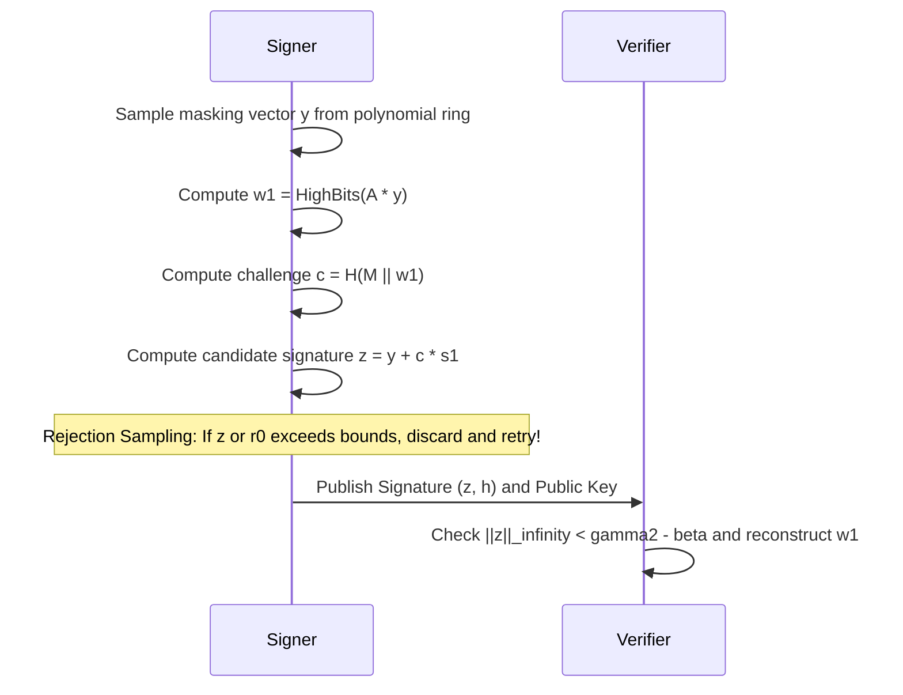

# NIST FIPS 204: ML-DSA (Dilithium) Lattice Signature Architecture

ML-DSA is the standardized post-quantum digital signature algorithm based on the Module Learning With Errors and Module Short Integer Solution problems, utilizing rejection sampling to eliminate secret key leakage.

---

## 1. NTT Acceleration

Polynomial multiplications are accelerated by transforming polynomials to the frequency domain using the Number Theoretic Transform:
$$a \cdot b = 	ext{iNTT}(	ext{NTT}(a) \odot 	ext{NTT}(b))$$
reducing multiplication complexity from $O(n^2)$ to $O(n \log n)$.
