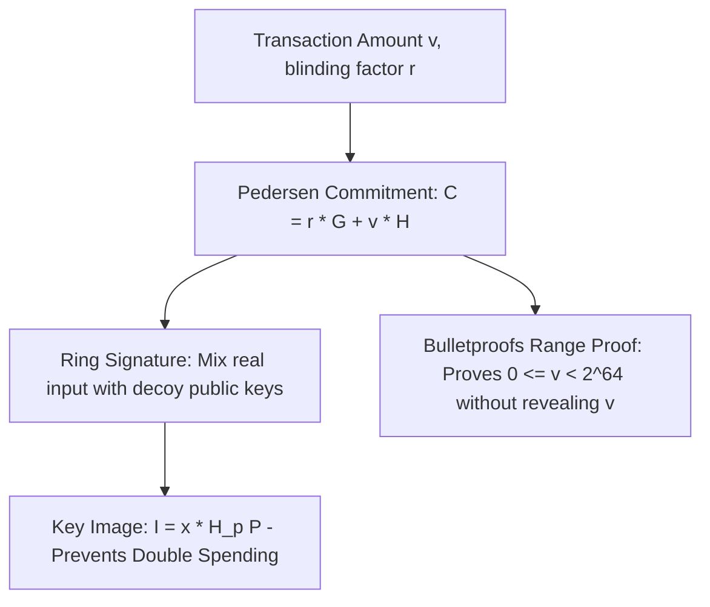

# Monero RingCT: Ring Signatures & Pedersen Commitments

Ring Confidential Transactions (RingCT) obscure transaction amounts and sender identity by pairing homomorphic Pedersen commitments with MLSAG ring signatures.

---

## 1. Homomorphic Balance Invariant

$$\sum C_{	ext{inputs}} - \sum C_{	ext{outputs}} = \left(\sum r_{	ext{in}} - \sum r_{	ext{out}}
ight) G + \left(\sum v_{	ext{in}} - \sum v_{	ext{out}}
ight) H$$
When $\sum v_{	ext{in}} = \sum v_{	ext{out}}$, the $H$ term vanishes, proving balance without exposing values.
