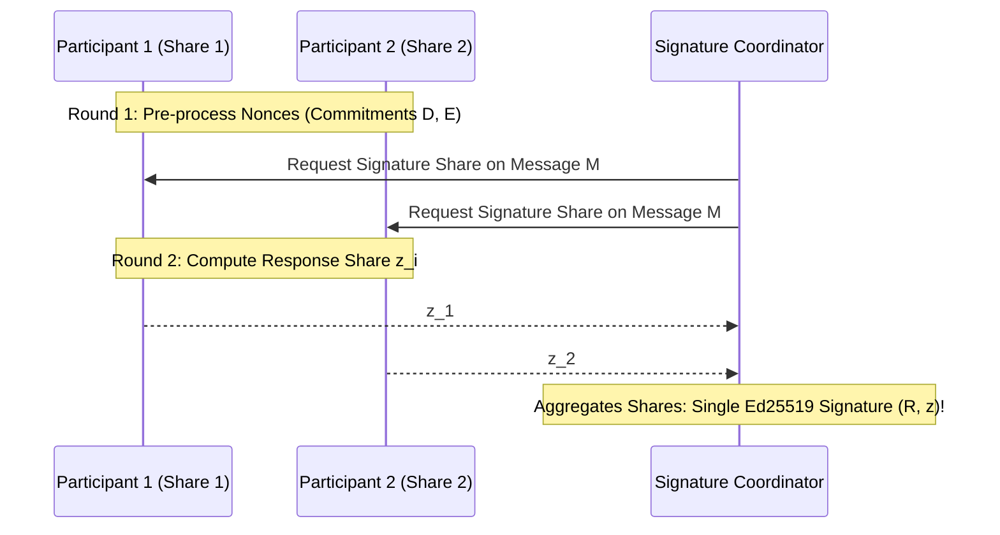

# Threshold Security: FROST Flexible Round-Optimized Schnorr Signatures

FROST provides $t$-of-$n$ threshold Schnorr signatures (Ed25519) in two network rounds, producing standard signatures indistinguishable from single-signer keys.

---

## 1. Verification Invariant
External verifiers use standard Ed25519 verification algorithms; they cannot detect that a threshold of independent signers produced the signature.
