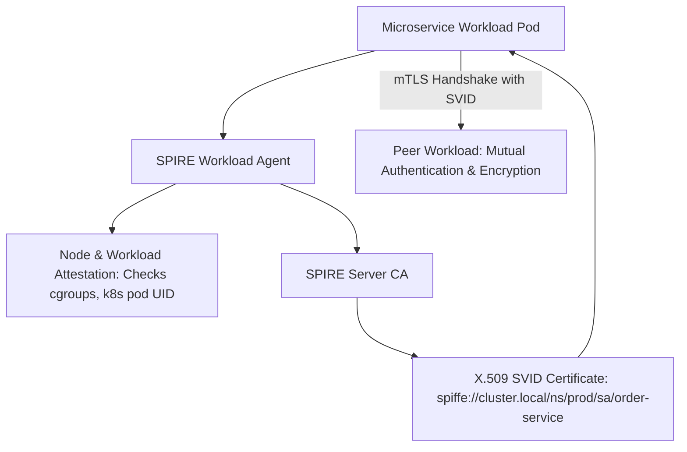

# Zero-Trust Infrastructure: SPIFFE ID and SPIRE Attestation

The Secure Production Identity Framework for Everyone (SPIFFE) assigns cryptographic identities to microservices, eliminating static API tokens and shared secrets.

---

## 1. SVID Rotation
SPIFFE Verifiable Identity Documents (SVID) typically have short lifespans (e.g. 1 hour) and are automatically rotated via local UNIX domain sockets without restarting application pods.
