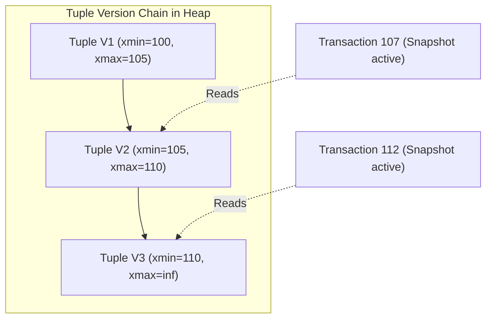

# MVCC: Snapshot Isolation & Serializable Snapshot Isolation (SSI)

Multi-Version Concurrency Control allows readers to access historical data without acquiring read locks, while SSI tracks rw-antidependencies to prevent write skew without pessimistic locks.

---

## 1. Anomalies and Mitigations

* **Write Skew:** Occurs under standard Snapshot Isolation when two transactions read overlapping datasets, verify disjoint invariants, and update disjoint keys (e.g., doctor on-call scheduling).
* **SIREAD Lock Tracking (SSI):** PostgreSQL SSI does not block readers. Instead, it tracks dynamic reader-writer conflicts (`rw-antidependencies`). If a cycle $T_1 \xrightarrow{rw} T_2 \xrightarrow{rw} T_1$ emerges, one transaction aborts with a serialization failure.
