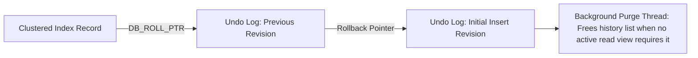

# MySQL Internals: InnoDB Undo Logs and Purge Threads

InnoDB implements Multi-Version Concurrency Control (MVCC) by writing old column values to Undo Logs, linked via the hidden `DB_ROLL_PTR` pointer on each clustered index record.

---

## 1. Read View Resolution
When a transaction executes with `REPEATABLE READ`, it takes a snapshot of active transactions (`read_view`). If a record's `DB_TRX_ID` is higher than the view's upper bound, InnoDB walks back the undo chain until it finds a visible revision.
