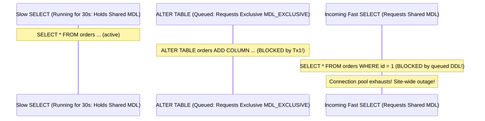

# MySQL Internals: Metadata Locks (MDL) and Table Lock Queuing

MySQL acquires Metadata Locks (MDL) during DDL statements (`ALTER TABLE`). A slow `SELECT` query can queue an `ALTER`, which subsequently blocks all future incoming `SELECT` queries!



---

## 1. Safe Migration Rule
Always set a tight DDL lock wait timeout before running migrations:
```sql
SET lock_wait_timeout = 5;
ALTER TABLE orders ADD COLUMN status VARCHAR(32);
```
