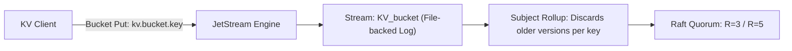

# NATS JetStream: Distributed Key-Value Store Internals

NATS JetStream embeds a distributed key-value store directly into its pub/sub messaging broker using stream consumers and lightweight Raft consensus groups.

---

## 1. Implementation Characteristics

* **Streams as Key-Value Stores:** Keys map to stream subjects (`$KV.<bucket>.<key>`). Each put appends a message; updates trigger subject rollups to retain the latest value.
* **Watch API via Subscriptions:** Watch operations map to standard NATS message subscriptions, delivering sub-millisecond change notifications without polling.
