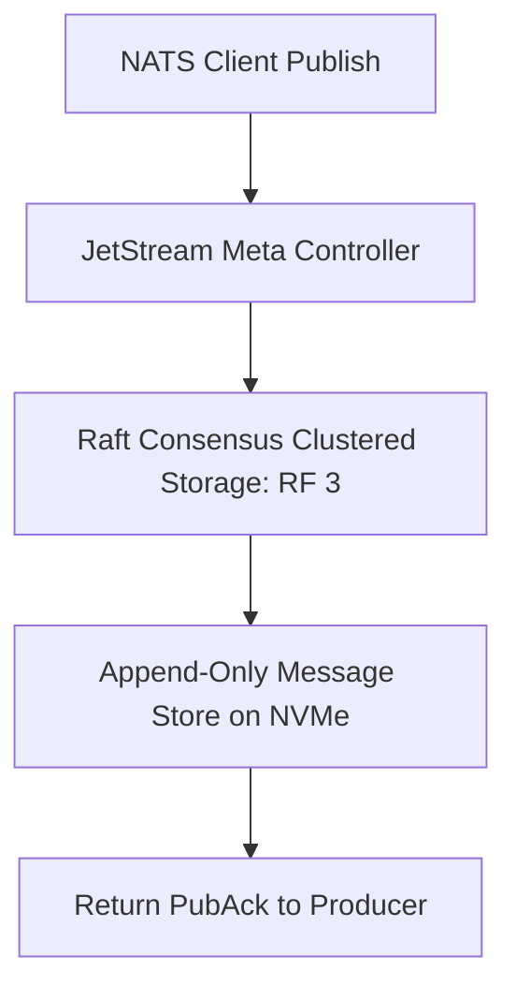

# Cloud Messaging: NATS JetStream Distributed Storage

NATS JetStream adds persistence, deduplication, and KV/object storage to lightweight pub/sub using Raft consensus.

---

## 1. Memory vs File Streams
Streams can be configured as `File` (durable against node crashes) or `Memory` (ultra-fast in-memory replicated buffer).
