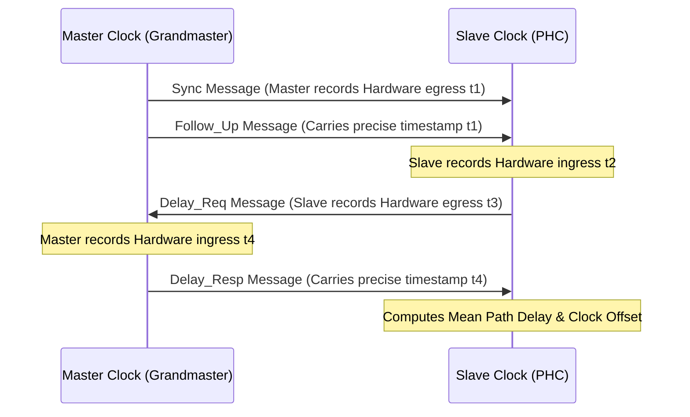

# High-Precision Timing: IEEE 1588 PTP & Hardware PHY Timestamping

Precision Time Protocol (IEEE 1588 PTP / IEEE 802.1AS) synchronizes distributed clocks with sub-microsecond accuracy by recording hardware timestamps directly at the physical Ethernet PHY transceiver layer, bypassing OS kernel stack jitter.

---

## 1. Calculation Equations

$$	ext{One-Way Delay} = rac{(t_4 - t_1) - (t_3 - t_2)}{2}$$

$$	ext{Clock Offset} = rac{(t_2 - t_1) - (t_4 - t_3)}{2}$$

* **PTP Hardware Clock (PHC):** Linux exposes hardware clocks via `/dev/ptpX`. The `phc2sys` daemon synchronizes the system clock (`CLOCK_REALTIME`) to the hardware PHC device.
