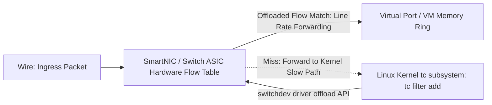

# Network Virtualization: Linux Traffic Control (tc-flower) Hardware Offload

Linux `tc-flower` classifies network packets across Layer 2 through Layer 4 headers, offloading flow tables directly into switch ASICs and SmartNICs via the kernel `switchdev` driver subsystem.



---

## 1. Flow Configuration & Offload Syntax

```bash
# Direct flow offload rule to hardware switch
tc filter add dev eth0 ingress protocol ip flower \
    skip_sw \
    dst_ip 10.0.0.50/32 \
    ip_proto tcp \
    dst_port 443 \
    action mirred egress redirect dev veth1
```

* **`skip_sw` Flag:** Enforces that the rule must be programmed into hardware ASIC registers; if the hardware table is full or unsupported, the command fails immediately rather than falling back to slow software emulation.
* **`switchdev` Framework:** Exposes hardware switch ports as regular Linux network devices (`vportX`), enabling standard Linux utilities to configure enterprise hardware switches.
