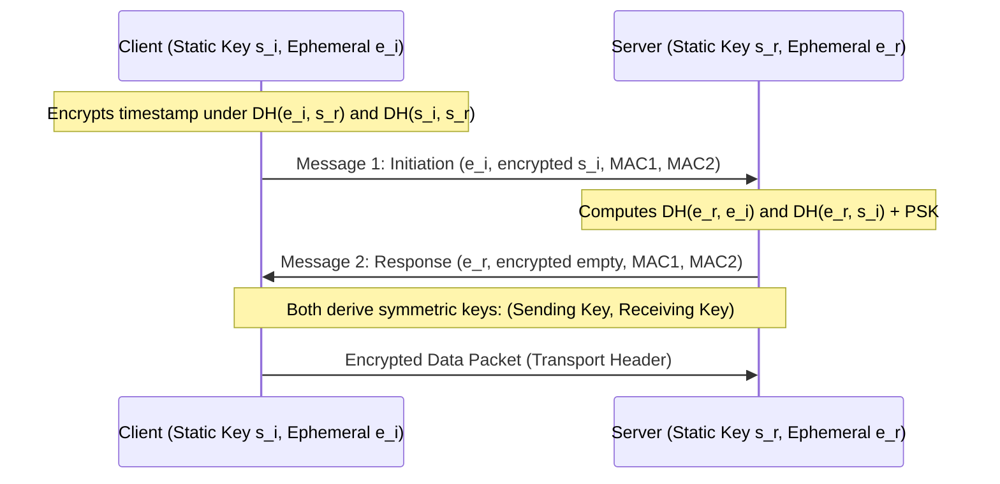

# Network Security: WireGuard Noise_IKpsk2 Handshake Protocol

WireGuard replaces complex VPN protocols with the Noise_IKpsk2 cryptographic protocol, completing secure authenticated mutual key exchange in a single round-trip (1-RTT).

---

## 1. State Machine & Denial-of-Service Defense

1. **Passive Identity Hiding:** Initiator static public key is encrypted on the wire; external eavesdroppers cannot determine participant identities.
2. **Cookie Reply (`MAC2`):** Under high CPU load or SYN floods, the responder sends back a tiny stateless cookie rather than performing expensive curve operations, defeating DoS attacks.
3. **Re-Keying Limits:** Sessions re-key automatically every 2 minutes or after transmitting $2^{64} - 2^{13} - 1$ transport messages.
