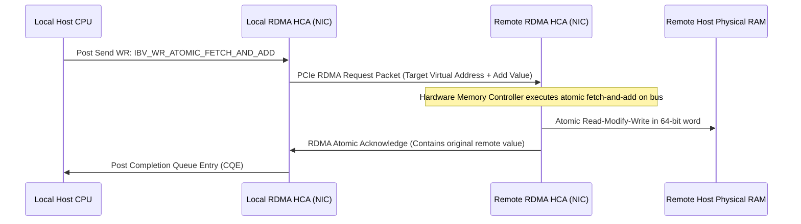

# Ultra-Low Latency: RDMA InfiniBand Atomic Fetch-and-Add & Compare-and-Swap

Remote Direct Memory Access (RDMA) over InfiniBand and RoCEv2 supports hardware-enforced remote atomic operations, allowing nodes to modify 64-bit remote host memory without interrupting remote CPUs.

---

## 1. Remote Atomic Invariants

* **Supported Operations:**
  - `IBV_WR_ATOMIC_FETCH_AND_ADD`: Atomically adds a 64-bit value to target memory location and returns previous value.
  - `IBV_WR_ATOMIC_CMP_AND_SWP`: Atomically compares memory against `compare_add` and swaps with `swap` if equal.
* **Alignment Constraint:** Remote target addresses must be strictly 8-byte aligned (64-bit boundaries).
* **Zero Remote CPU Intervention:** Remote CPU cores continue processing application workloads while the HCA memory controller executes the transaction.
