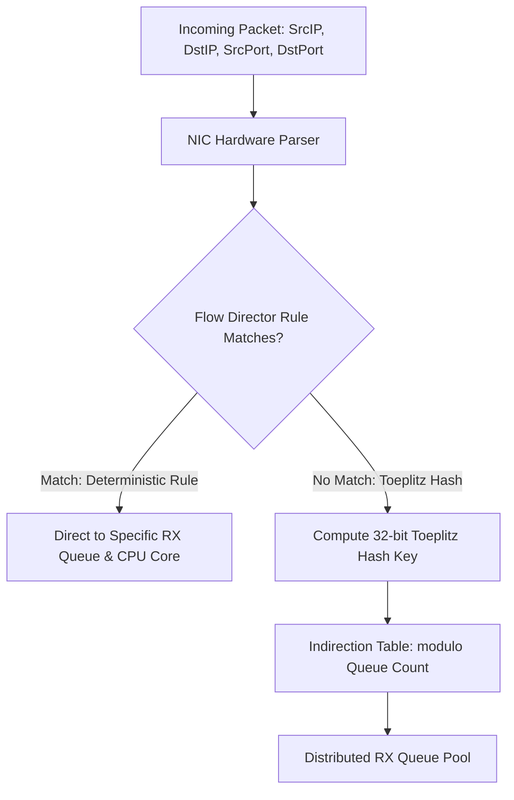

# NIC Receive Side Scaling (RSS) & Flow Director Steering

Hardware RSS hashes incoming 4-tuple IP packet headers across RX queues, while Intel Flow Director (FDir) applies deterministic hardware flow rules to pin specific connections to dedicated CPU cores.

---

## 1. Toeplitz Hash Invariant

The Toeplitz hash function ensures symmetric hashing: forward and reverse directions of a TCP flow hash to identical queue indices, keeping connection states localized to a single CPU L1 cache.
