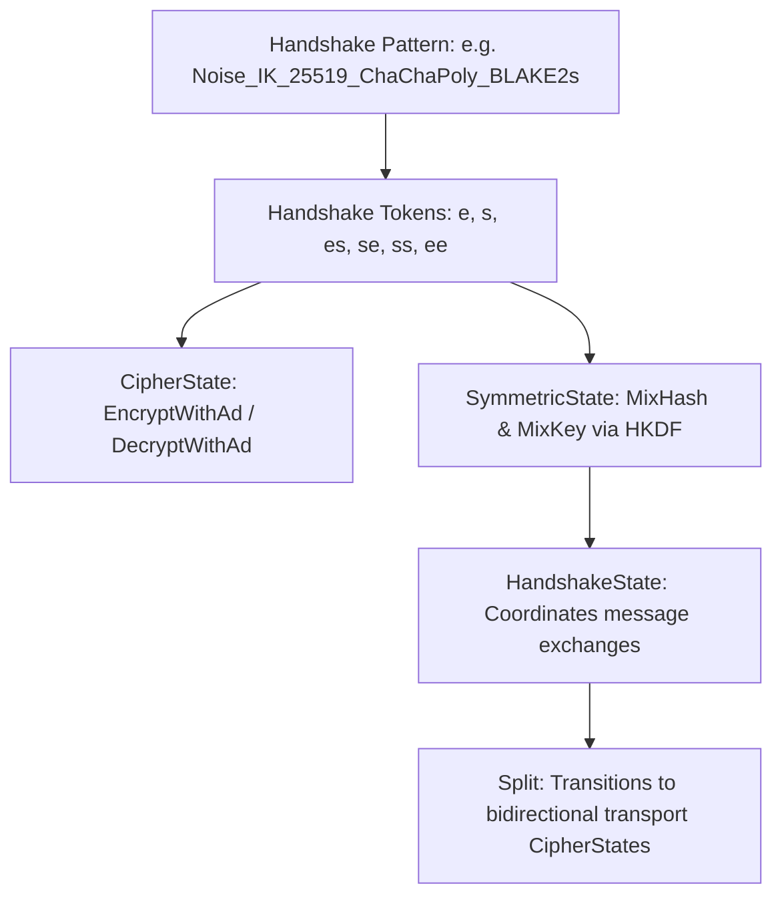

# Noise Protocol Framework: Handshake State Machine Architecture

Noise provides a formal grammar for composing mutual authentication and authenticated encryption protocols from Diffie-Hellman primitives (used in WireGuard, Lightning Network, and I2P).

---

## 1. Common Handshake Patterns

* **Noise_IK:** Initiator knows responder's static public key beforehand; transmits 0-RTT encrypted payload in the first flight. (WireGuard default).
* **Noise_XX:** Mutual authentication without pre-shared keys; both parties exchange ephemeral and static public keys in 3 message flights.
