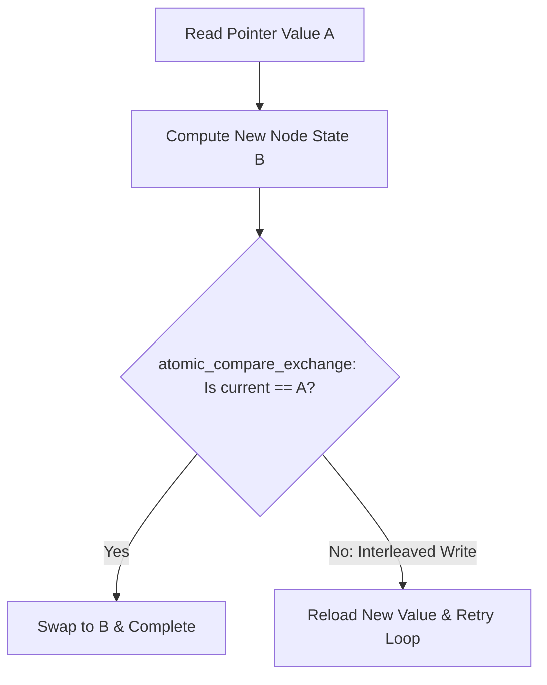

# Non-Blocking Synchronization: CAS, FAA & ABA Mitigation

Lock-free algorithms rely on hardware atomic instructions (Compare-and-Swap and Fetch-and-Add) to mutate shared state without lock acquisition overhead.



---

## 1. Atomic Primitives Performance

| Primitive | x86 Instruction | ARMv8 Instruction | Bus Lock Mechanism | Latency (Uncontended) |
|---|---|---|---|---|
| **Atomic Store** | `mov` | `stlr` | Local L1 cache line store | ~1 ns |
| **Fetch-And-Add** | `lock xadd` | `ldaddal` | In-cache atomics via MESI cache state | ~8–12 ns |
| **Compare-And-Swap** | `lock cmpxchg` | `casal` | In-cache atomics via MESI cache state | ~10–14 ns |

---

## 2. ABA Problem Mitigation via Tagged Pointers

```cpp
#include <atomic>
#include <cstdint>

template <typename T>
struct TaggedPointer {
    T* ptr;
    uint64_t tag; // Monotonically increasing generation counter
};

template <typename T>
class LockFreeStack {
    struct Node {
        T data;
        TaggedPointer<Node> next;
    };

    std::atomic<TaggedPointer<Node>> head_;

public:
    void push(T val) {
        Node* new_node = new Node{val, {nullptr, 0}};
        TaggedPointer<Node> old_head = head_.load(std::memory_order_relaxed);
        do {
            new_node->next = old_head;
        } while (!head_.compare_exchange_weak(
            old_head,
            {new_node, old_head.tag + 1},
            std::memory_order_release,
            std::memory_order_relaxed));
    }
};
```
