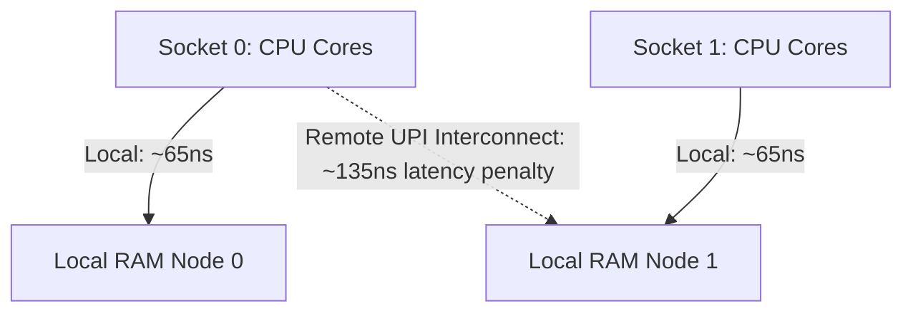

# NUMA: First-Touch Allocation & Memory Interleaving

Non-Uniform Memory Access (NUMA) systems incur latency penalties when CPU cores access memory controllers on remote sockets across Ultra Path Interconnect (UPI / Infinity Fabric) links.

---

## 1. Memory Policies

1. **First-Touch Policy (Linux Default):** Memory pages map to the NUMA node containing the CPU core that first writes (`touch`) the virtual address, not the allocating core.
2. **Interleave Mode (`MPOL_INTERLEAVE`):** Round-robins page allocations across all NUMA nodes; optimal for analytical databases avoiding single-node RAM saturation.
3. **Core Pinning (`numactl`):** Restricts high-performance threads and memory allocations strictly to a single NUMA domain (`numactl --cpunodebind=0 --membind=0`).
