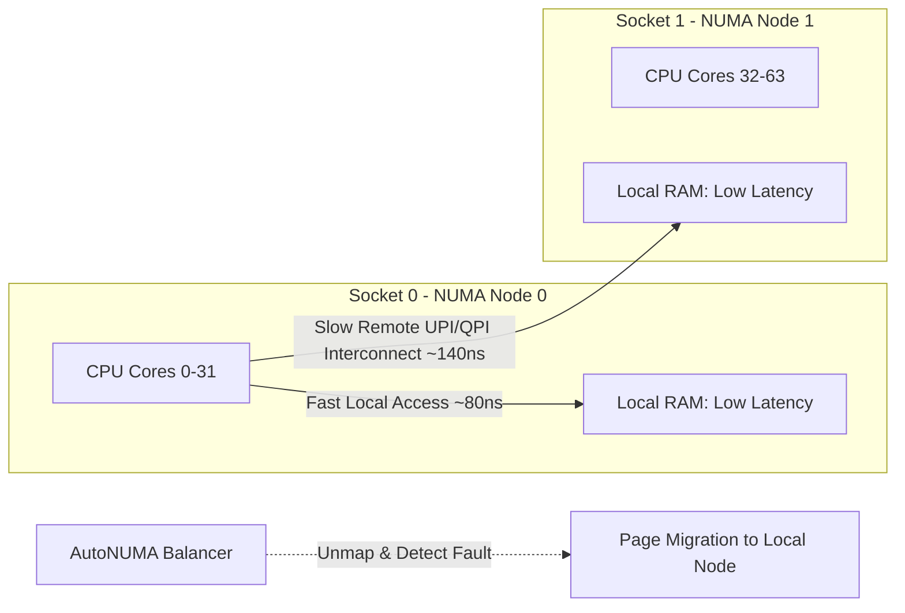

# NUMA Memory Balancing & Automatic Page Migration

Non-Uniform Memory Access systems partition physical RAM across CPU sockets. The kernel balancer samples unmapped pages to dynamically migrate memory closer to the consuming CPU node.



---

## 1. Kernel Optimization Flags

```bash
# Verify NUMA topology and locality hit rates
numactl --hardware
numastat -c

# Enforce strict node memory allocation
numactl --cpunodebind=0 --membind=0 ./high-perf-app
```
