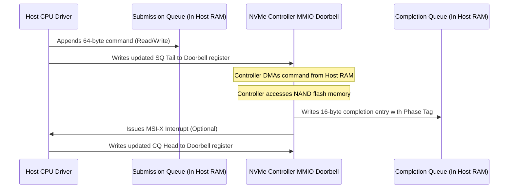

# NVMe: Submission & Completion Queue Architecture

Non-Volatile Memory Express (NVMe) eliminates SATA/AHCI single-queue bottlenecks by supporting up to 64,000 paired hardware queues with 64,000 commands each.

---

## 1. Key Invariants

* **Phase Tag Bit:** Completion entries contain an alternating phase bit, allowing the host driver to detect new completions in circular buffers without memory fences.
* **CPU Core Affinity:** High-performance Linux drivers allocate dedicated Submission/Completion queue pairs per CPU core to prevent cross-core synchronization locks.
