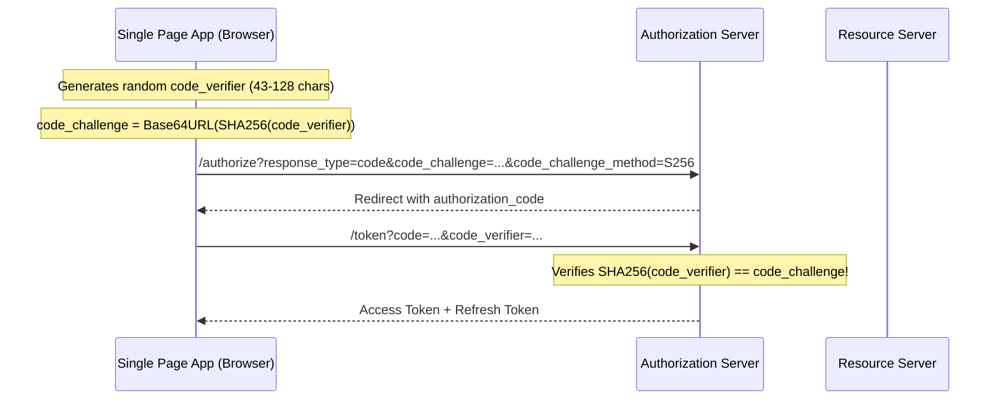

# Identity & Access: OAuth 2.0 Authorization Code Flow with PKCE

Proof Key for Code Exchange (PKCE, RFC 7636) prevents authorization code interception attacks on public clients (Single-Page Apps, mobile apps) that cannot protect client secrets.

---

## 1. Protection Guarantee
Even if a malicious native app intercepts the authorization code via custom URI schemes, it cannot exchange it for tokens because it lacks the original `code_verifier`.
