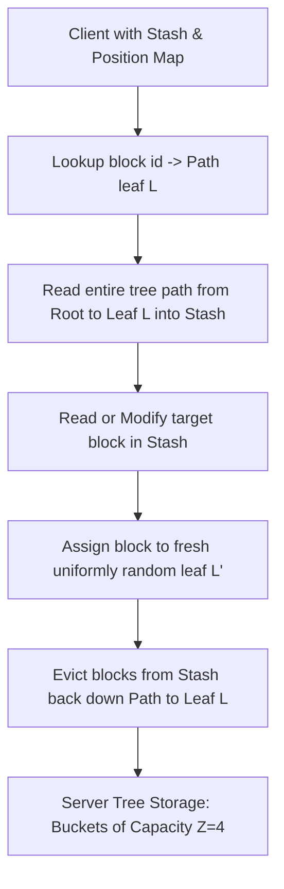

# Path ORAM (Oblivious RAM) Architecture

Path ORAM hides physical memory access patterns (read/write locations, frequencies, timing) from an adversary observing cloud storage or memory bus traces.

---

## 1. Architectural Characteristics

* **Tree Structure:** Complete binary tree of depth $D = \lceil \log_2 N 
ceil$.
* **Bucket Capacity:** Each node contains a bucket holding $Z$ blocks (typically $Z = 4$).
* **Stash:** Client-side local buffer holding blocks that cannot fit back down their paths.
* **Position Map:** Lookup table mapping `block_id -> leaf_id` stored on client or recursively in smaller ORAM trees.

---

## 2. Path Eviction Invariants

When writing back blocks from stash to server along path to leaf $L$:
1. A block mapped to leaf $L'$ can only be placed in node $v$ if $v$ is an ancestor of both $L$ and $L'$.
2. Greedy eviction pushes each block as deep down the path toward $L$ as possible without exceeding bucket capacity $Z$.
3. With $Z=4$, probability of stash overflow decreases exponentially with stash size: $P(	ext{Stash} > R) < 2^{-c R}$.
