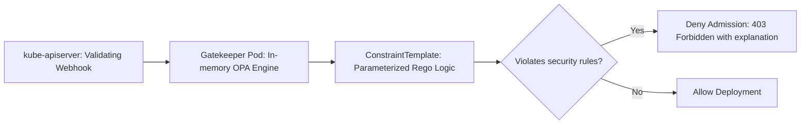

# Policy Enforcement: Open Policy Agent (OPA) Gatekeeper

Gatekeeper enforces declarative security policies (preventing privileged containers, mandating resource limits) via declarative Rego rules.

---

## 1. Audit Mode
Gatekeeper continuously audits running resources against active constraints, reporting non-compliant historical workloads without disrupting active traffic.
