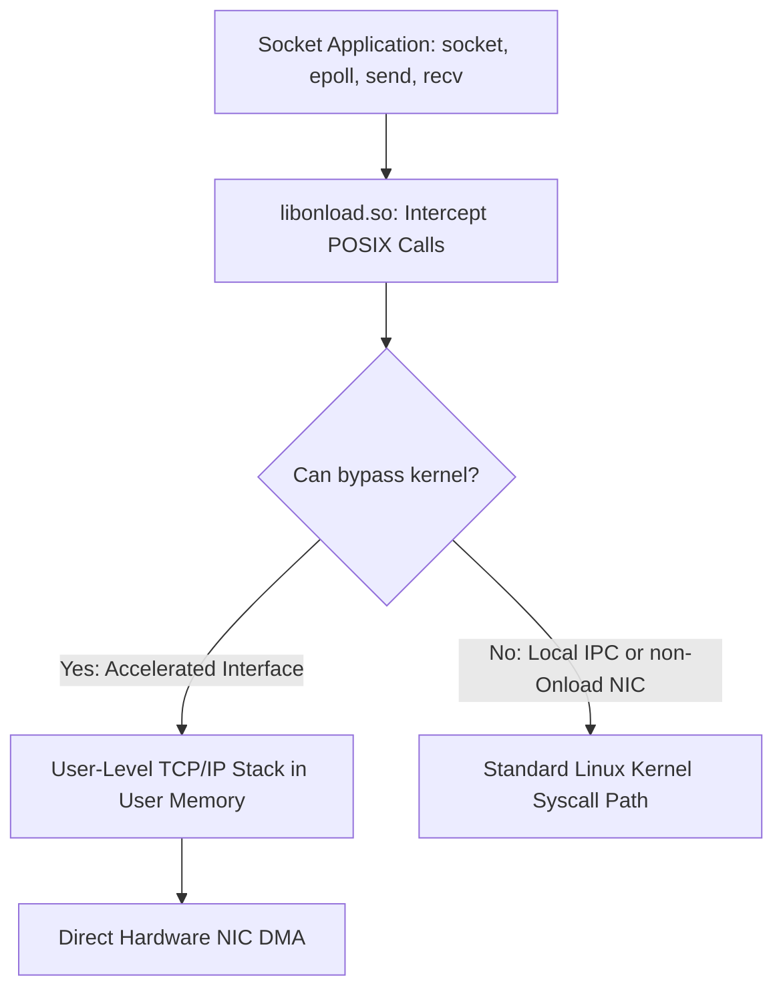

# OpenOnload User-Level TCP/IP Stack Architecture

OpenOnload intercepts standard POSIX socket API calls via dynamic library linking (`LD_PRELOAD`), routing network traffic entirely in user-space without kernel system calls or context switches.

---

## 1. Intercept Mechanisms

* **Zero Application Code Changes:** Operates transparently on existing binary applications using `onload ./trading_engine`.
* **Shared Memory Sockets:** Sockets connecting processes on the same host transfer packets through lock-free shared memory rings, bypassing physical loopback hardware.
