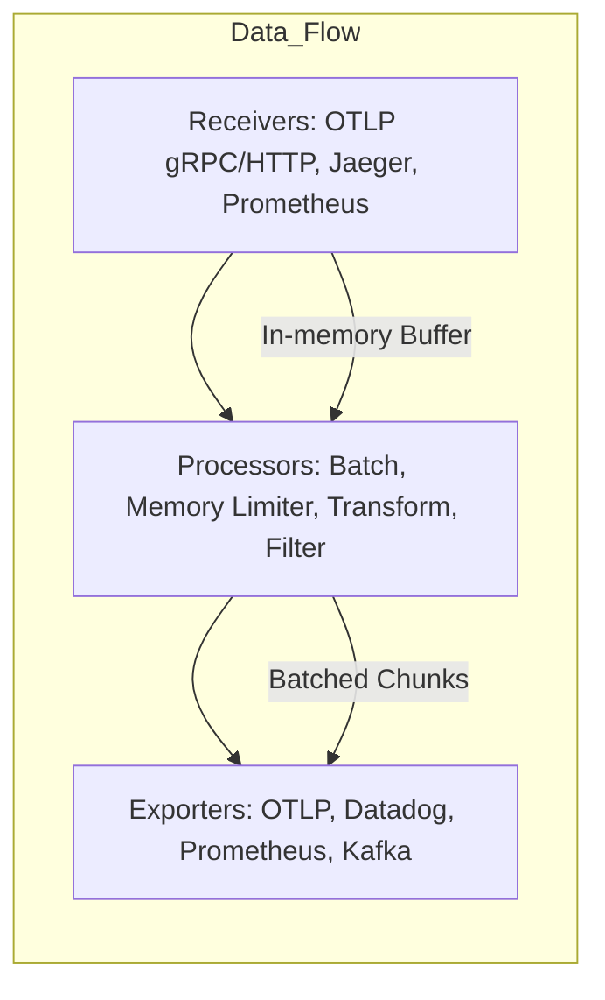

# Observability: OpenTelemetry Collector Pipeline Architecture

The OpenTelemetry Collector provides vendor-agnostic ingestion, transformation, and routing for distributed traces, metrics, and logs.

---

## 1. Memory Limiter Processor
Mandatory in production: Monitors heap usage and drops or rejects incoming telemetry with backpressure when consumption approaches hard container limits.
