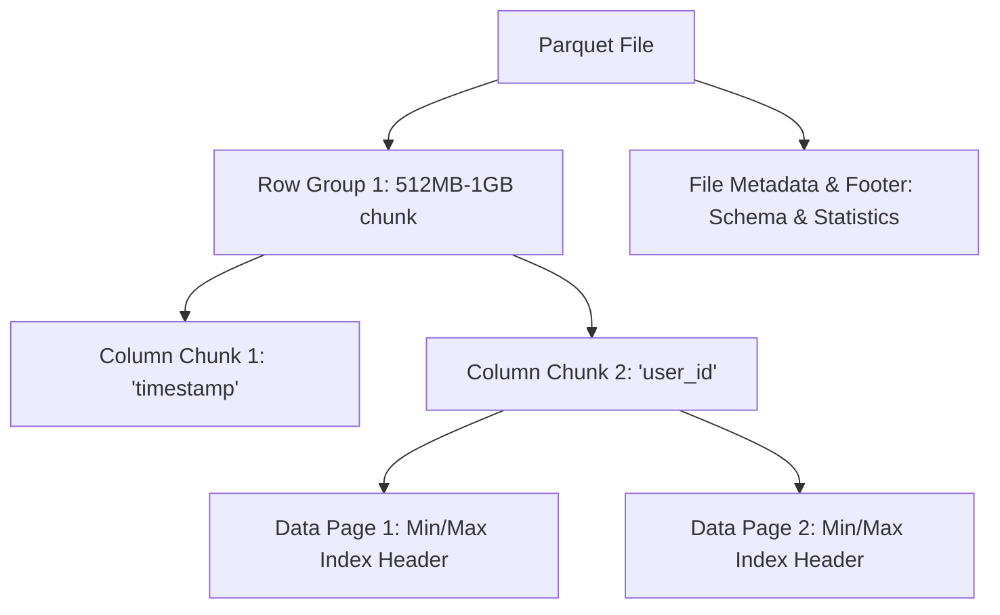

# Data Engineering: Apache Parquet Physical Layout Architecture

Apache Parquet is an open-source columnar storage format designed for efficient analytical query execution with predicate pushdown.

---

## 1. Predicate Pushdown Mechanics
Query engines (DuckDB, Trino, Spark) inspect the file footer before reading column data:
- If `user_id > 1000` and Page 1 metadata indicates `Max = 999`, the entire Data Page is skipped without I/O.
