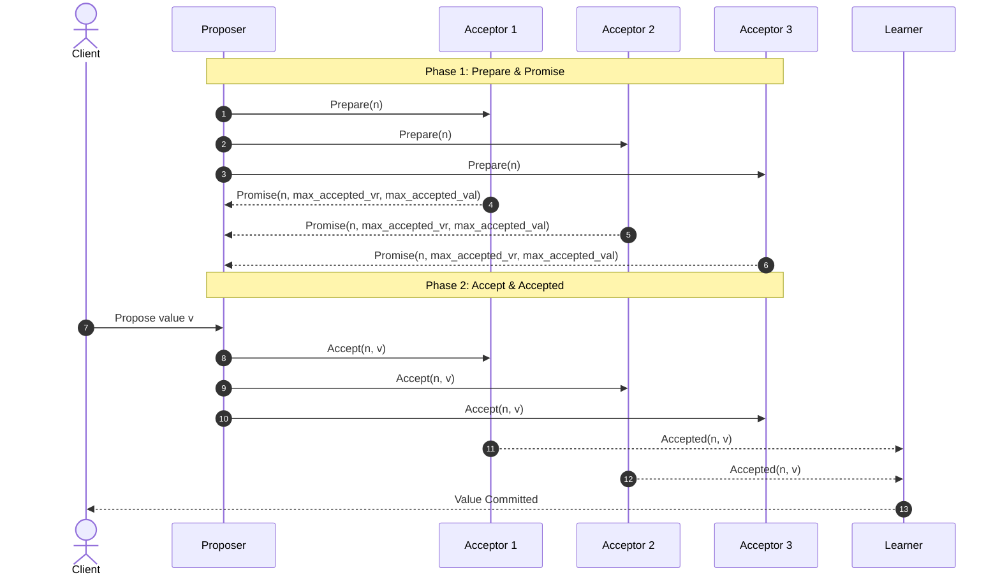

# Paxos Distributed Consensus Protocol

Paxos establishes consensus across a network of untrusted or unreliable nodes communicating over asynchronous, lossy networks. It guarantees safety under arbitrary message delays, packet drops, reordering, and node crashes without network partitions causing split-brain states.

## Protocol Roles

1. **Proposers:** Propose values from clients and drive consensus rounds.
2. **Acceptors:** Form the stateful memory of the cluster. They store promises and accepted values in persistent storage before responding.
3. **Learners:** Observe consensus decisions once a quorum of Acceptors agrees.

A single node frequently acts as Proposer, Acceptor, and Learner simultaneously.

---

## Phase Execution Details

### Phase 1a: Prepare
A Proposer generates a globally unique, monotonically increasing proposal number $n$:
$$n = (\text{round\_counter} \cdot \text{num\_nodes}) + \text{node\_id}$$
The Proposer sends $\text{Prepare}(n)$ to a majority quorum of Acceptors.

### Phase 1b: Promise
When an Acceptor receives $\text{Prepare}(n)$:
- If $n > n_{\text{promised}}$:
  - Set $n_{\text{promised}} = n$.
  - Reply with $\text{Promise}(n, v_{\text{accepted\_max\_round}}, v_{\text{accepted\_value}})$.
  - Commit to reject or ignore any future proposal with number $n' < n$.
- Else:
  - Reject proposal or do not respond.

### Phase 2a: Accept
Once the Proposer receives promises from a majority of Acceptors:
- If any Acceptor reported a previously accepted value in its promise, the Proposer **must** adopt the value associated with the highest proposal number returned.
- If no Acceptor reported an accepted value, the Proposer selects its own proposed value $v$.
- The Proposer sends $\text{Accept}(n, v)$ to the majority quorum.

### Phase 2b: Accepted
When an Acceptor receives $\text{Accept}(n, v)$:
- If $n \geq n_{\text{promised}}$:
  - Set $n_{\text{accepted}} = n$ and $v_{\text{accepted}} = v$.
  - Persist to write-ahead log (WAL).
  - Broadcast $\text{Accepted}(n, v)$ to the Proposer and all Learners.
- Else:
  - Reject proposal.

---

## Quorum Invariant Guarantee

For any two quorums $Q_1$ and $Q_2$ in a cluster of $2F + 1$ Acceptors:
$$|Q_1| = F + 1, \quad |Q_2| = F + 1 \implies Q_1 \cap Q_2 \neq \emptyset$$
Because every majority shares at least one Acceptor, any subsequent proposal in Phase 1 must discover the highest-numbered value accepted in any previous round. Conflicting values cannot achieve consensus.

---

## Multi-Paxos Optimization

Basic Paxos requires two full round-trips (Phase 1 + Phase 2) for every log entry. Multi-Paxos optimizes steady-state throughput:
1. Run Phase 1 once to elect a stable Leader for an epoch.
2. For all subsequent log entries, execute Phase 2 directly with a single round-trip:
   $$\text{Leader} \xrightarrow{\text{Accept}(i, n, v)} \text{Acceptors} \xrightarrow{\text{Accepted}(i, n, v)} \text{Learners}$$
3. When the Leader fails or lease expires, a new Leader runs Phase 1 across all uncommitted slots.

---

## Comparison Matrix: Paxos vs Raft vs Zab

| Property | Basic Paxos | Multi-Paxos | Raft | ZAB (ZooKeeper) |
| --- | --- | --- | --- | --- |
| **Consensus Granularity** | Single value per instance | Continuous log stream | Continuous log stream | Continuous transaction stream |
| **Leader Dependency** | Symmetric (any node can propose) | Dedicated Leader optimization | Mandatory strong leader | Primary-Backup with Leader |
| **Message Rounds (Steady State)** | 2 RTT (Prepare + Accept) | 1 RTT (Accept only) | 1 RTT (AppendEntries) | 1 RTT (Proposal + Ack) |
| **Log Discontinuity** | Allows out-of-order slot agreement | Allows out-of-order commit slots | Strict prefix matching (no log gaps allowed) | Strict prefix matching |
| **Membership Changes** | State machine transition | Instance-level reconfiguration | Joint consensus / single-server transition | Reconfig transactions |
