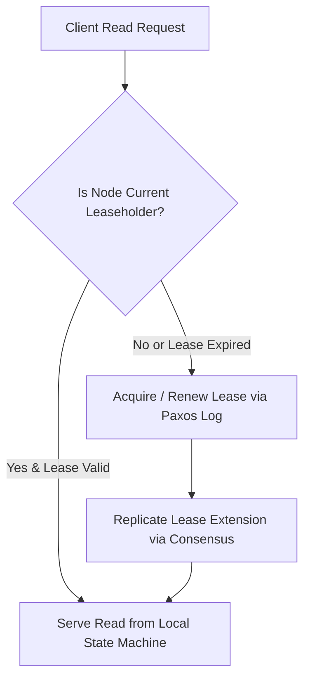

# Distributed Consensus: Paxos Leaseholder Reads and Epoch Tracking

To avoid running full Multi-Paxos or Raft consensus on read-only queries, systems like CockroachDB and Google Spanner utilize Leaseholders with synchronized physical clocks or heartbeat intervals.

---

## 1. Core Mechanics
1. **Consensus-Acquired Leases:** The lease is granted by consensus among replicas for a fixed duration (e.g., 6 seconds).
2. **Epoch Tracking:** Whenever node membership or lease boundaries change, an epoch counter increments.
3. **Linearizability Guarantee:** While a valid lease is held, no other replica can be granted a lease for overlapping keyspaces.
