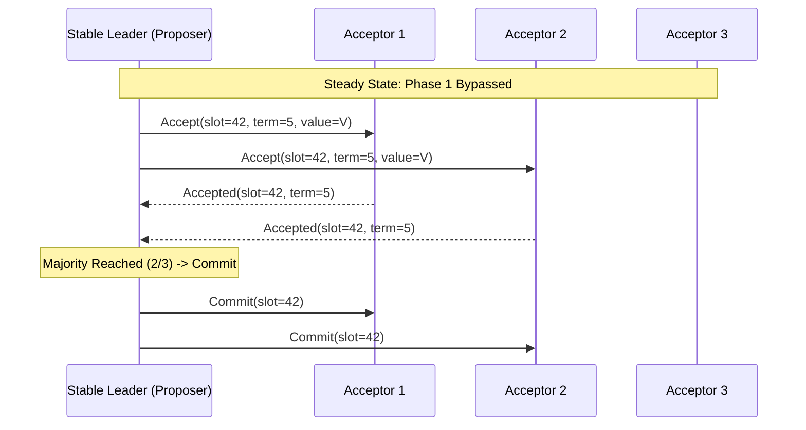

# Multi-Paxos: State Machine Replication Architecture

Multi-Paxos optimizes basic single-decree Paxos for sequences of commands, eliminating Phase 1 (Prepare/Promise) roundtrips during steady-state leadership.

---

## 1. Key Invariants

1. **Stable Leader Election:** Proposers negotiate leadership once using Phase 1 across all upcoming slots. Once established, proposals require only Phase 2 (Accept/Accepted).
2. **Log Holes:** Missing slots caused by network partitions or uncommitted ballot proposals are filled with no-op operations to keep sequential log order intact.
3. **Reconfiguration:** Cluster membership shifts (e.g., adding nodes) are serialized as log state machine transitions, taking effect after an offset delay $k$.
