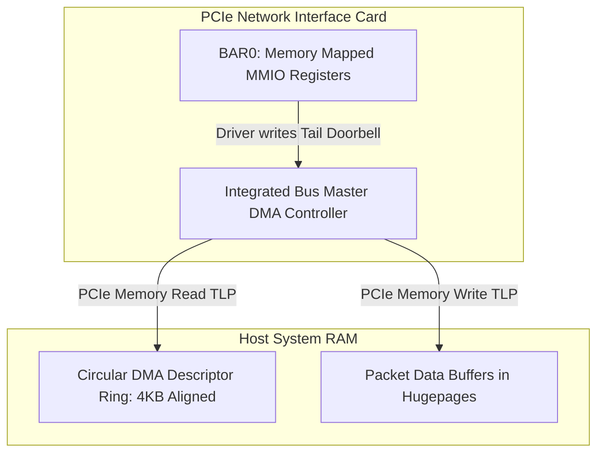

# PCIe: Transaction Layer Packets (TLP) & DMA Descriptor Rings

High-speed network cards and NVMe drives coordinate host memory transfers using PCIe Transaction Layer Packets governed by Base Address Register (BAR) windowing and circular descriptor rings.

---

## 1. TLP Transaction Phases

1. **Doorbell Write:** The CPU driver writes the updated ring index to the device's MMIO register via a 32-bit or 64-bit PCIe non-posted memory write TLP.
2. **Descriptor Fetch:** The device initiates Bus Mastering DMA, issuing posted memory read TLPs across PCIe switches to fetch ring descriptors.
3. **Completion Acknowledgment:** MSI-X interrupts signal transaction completion to designated CPU core vectors.
